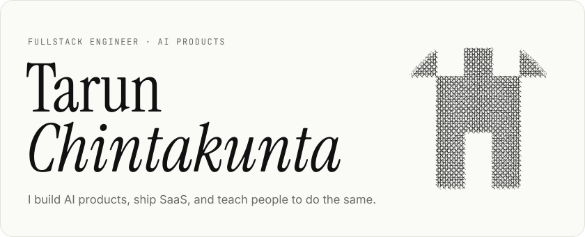
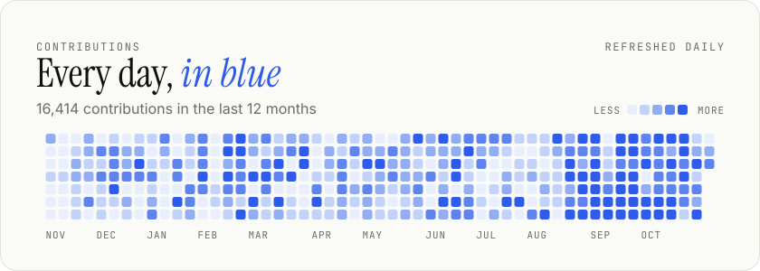
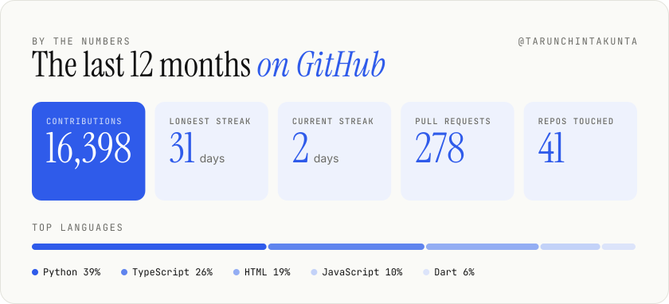
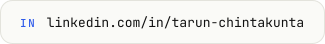

  <a href="https://tarunchintakunta.com">
    <picture>
      <source media="(prefers-color-scheme: dark)" srcset="assets/hero-dark.svg">
      
    </picture>
  </a>

  <a href="https://github.com/Tarunchintakunta?tab=overview">
    <picture>
      <source media="(prefers-color-scheme: dark)" srcset="assets/activity-dark.svg">
      
    </picture>
  </a>

  <a href="https://github.com/Tarunchintakunta?tab=repositories">
    <picture>
      <source media="(prefers-color-scheme: dark)" srcset="assets/stats-dark.svg">
      
    </picture>
  </a>

  <a href="https://tarunchintakunta.com"><picture><source media="(prefers-color-scheme: dark)" srcset="assets/link-website-dark.svg"></picture></a>
  <a href="https://www.linkedin.com/in/tarun-chintakunta"><picture><source media="(prefers-color-scheme: dark)" srcset="assets/link-linkedin-dark.svg"></picture></a>
  <a href="mailto:tarunchintakunta@gmail.com"><picture><source media="(prefers-color-scheme: dark)" srcset="assets/link-email-dark.svg"></picture></a>

